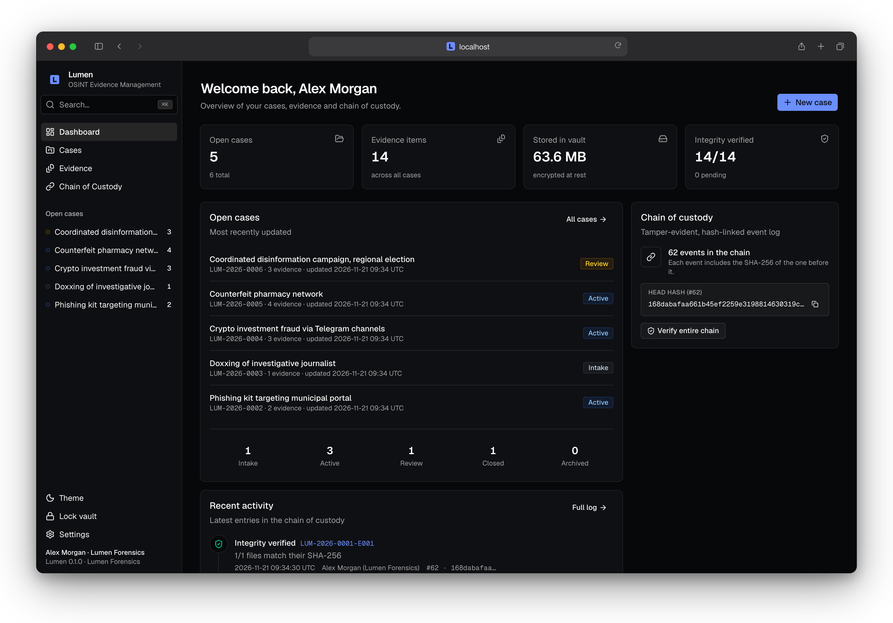

# Lumen

**An open-source OSINT Evidence Management System (EMS) by Lumen Forensics.**

Lumen helps an investigator register, preserve and account for digital evidence. Every file is
fingerprinted with SHA-256, encrypted in an isolated vault, and tracked in a tamper-evident chain of
custody, from the moment it is collected to the moment it is handed over.



- **Cases.** Open cases, move them through *Intake → Active → Review → Closed → Archived*, keep
  timestamped notes.
- **Evidence registration.** Upload any file. It is hashed in your browser, hashed again by the vault,
  and only registered if both SHA-256 values match. SHA-1 and MD5 are recorded for legacy tools.
- **Web capture.** Paste a URL. Lumen opens it in a fresh, isolated browser and preserves a full-page
  screenshot, rendered HTML, an MHTML archive, HTTP headers, redirect chain, remote IP, TLS certificate
  and DNS records, all hashed and sealed as one exhibit.
- **Chain of custody.** Every action, including views and downloads, is an append-only event whose
  hash includes the previous event's hash. Edits, deletions or reordering are detectable.
- **Integrity checks.** Stored evidence is re-hashed on a schedule (default every 24h) and on demand.
- **Court-ready export.** One click produces a zip with the evidence, a manifest, the custody log,
  a printable chain-of-custody report and `SHA256SUMS`. It can be verified offline, without Lumen.
- **Hardware security keys.** Register a YubiKey or other FIDO2 key and the vault starts locked:
  evidence can only be decrypted and viewed after you touch your key. See
  [Security keys](#security-keys).
- **Search** across cases, evidence, URLs, filenames and hashes (⌘K). Light and dark themes.

## Quick start

Requirements: Docker with Compose, and `openssl`.

```sh
git clone https://github.com/lumenforensics/lumen.git
cd lumen
./scripts/setup.sh            # creates .env with a new vault master key
docker compose up -d --build
```

Open **http://localhost:8080**, go to **Settings**, and enter your name. It is recorded as the actor
on every custody event.

> **Back up `LUMEN_MASTER_KEY` from `.env`.** It decrypts the vault. If you lose it, your stored
> evidence cannot be recovered. Keep a copy offline and separate from your data backups.
> Or register a security key (below): it replaces this key, and the recovery code becomes your backup.

## Security keys

Lumen can require a hardware security key, such as a YubiKey 5, to unlock the vault. Once a key is
registered:

- The vault **starts locked** on every boot. Nothing is served, not even case titles, until someone
  unlocks it in the browser by entering the key's PIN and touching it.
- The master key in `.env` is **replaced**. Registering the first key generates a new master key that
  exists only wrapped by your security keys and a recovery code (`keyslots.json` in the vault volume),
  and re-wraps every stored file's key under it. The old `LUMEN_MASTER_KEY`, and any copy or backup
  of it, no longer decrypts anything. While locked, the vault does not hold the master key in memory.
- Lumen **locks itself** after `LUMEN_IDLE_TIMEOUT` (default 15 minutes) without activity, or when you
  click **Lock vault**.
- Unlocking, locking, and adding or removing keys are **recorded in the chain of custody**.

**Set it up.** Open Lumen at **http://localhost:8080** (security keys do not work on an IP address
such as `127.0.0.1`), go to **Settings → Security keys**, and register your key. Then:

1. Store the **recovery code** you are shown offline. It is the only way in if every key is lost.
2. Register a **second key** as a backup.
3. Delete the old `LUMEN_MASTER_KEY` line from `.env`. It no longer works, so this is only tidying up.

Replacing the master key only rewrites a 60-byte header per file, so it takes seconds. The evidence
itself, and its SHA-256, does not change. If Lumen stops during re-encryption, it finishes on the
next unlock; keep `LUMEN_MASTER_KEY` in `.env` until Settings no longer says it is unfinished.

**How it works.** Lumen uses the WebAuthn PRF extension (CTAP2 `hmac-secret`). The key computes an
HMAC from a secret that never leaves the key, and that 32-byte result unwraps the master key
(HKDF-SHA256, then AES-256-GCM). User verification is required, so a stolen key without its PIN is
not enough. You need a key with `hmac-secret` support (YubiKey 5 series or newer, and most
current FIDO2 keys) and a current version of Chrome, Edge, Firefox or Safari.

**Limits.** This protects data at rest: a copied disk, a stolen backup or a leaked `.env`. It does not
protect a machine while Lumen is unlocked, and integrity checks and metadata extraction pause
while the vault is locked (they resume on the next unlock). The database (case titles, notes,
custody log) is not encrypted by the vault, but it is not served while locked. To protect it at
rest too, keep Docker's data on an encrypted disk (FileVault, BitLocker or LUKS).

## Architecture

```
browser ──► proxy (Caddy, localhost:8080)
              ├──► web      Next.js + Tailwind + shadcn/ui
              └──► api      Go: cases, evidence, custody chain, search, export
                     ├──► vault    Go: encrypted, content-addressed storage   [internal network]
                     ├──► db       PostgreSQL                                 [internal network]
                     └──► capture  Go + headless Chromium                     [internet egress only]
```

| Service | What it does |
|---|---|
| `proxy` | The only published port, bound to `127.0.0.1`. Routes `/api/*` to the API and everything else to the web app. |
| `web` | Next.js App Router UI. Server components read from the API; uploads stream through the proxy. |
| `api` | Go (stdlib `net/http`, `pgx`). Owns all business logic and writes every custody event in the same transaction as the change it records. |
| `vault` | Stores each file under the SHA-256 of its content, encrypted with a per-file AES-256-GCM key wrapped by the master key. Files are written once (mode `0400`). Lives on an internal network with no internet access; only the API can reach it, using a shared token. |
| `capture` | Runs one fresh headless Chromium per capture with a throwaway profile. Refuses private and LAN addresses by default. |
| `db` | PostgreSQL. Triggers forbid updating or deleting custody events and artifacts, and deleting cases or evidence. |

### How the chain of custody works

Each event's hash is SHA-256 over a length-prefixed encoding of its sequence number, id, case,
evidence, action, actor, details, timestamp and **the previous event's hash**
(see [`backend/internal/custody/chain.go`](backend/internal/custody/chain.go)). Changing any past event
changes its hash and breaks every link after it. **Chain of Custody → Verify entire chain**
recomputes the whole log.

Database triggers stop ordinary edits. The hash chain catches anyone who bypasses them, such as a
database superuser. To protect against someone rewriting the *entire* chain, record the **head hash**
somewhere outside Lumen at key moments, for example in your case notes, an email to yourself, or
a signed report.

### Vault encryption format

`magic | wrap nonce | wrapped data key | chunk*`, where each 64 KiB chunk is sealed with
AES-256-GCM using a nonce built from the chunk index and a final-chunk flag. Reordered, dropped or
truncated chunks fail authentication. See
[`backend/internal/vaultcrypto/stream.go`](backend/internal/vaultcrypto/stream.go).

## Verifying an export

```sh
unzip LUM-2026-0001_export_*.zip && cd LUM-2026-0001
shasum -a 256 -c SHA256SUMS                 # macOS  (Linux: sha256sum -c SHA256SUMS)

# or check files and custody events together:
cd backend && go run ./cmd/lumen-verify ../LUM-2026-0001_export_*.zip
```

## Configuration

All settings live in `.env` (generated by `scripts/setup.sh`):

| Variable | Default | Purpose |
|---|---|---|
| `LUMEN_MASTER_KEY` | generated | 32-byte base64 key that wraps every file key. **Back it up.** Replaced, and no longer needed, once you register a security key. |
| `VAULT_TOKEN` | generated | Shared secret between the API and the vault. |
| `POSTGRES_PASSWORD` | generated | Database password. |
| `LUMEN_PORT` | `8080` | Port on `127.0.0.1` where Lumen is served. |
| `VERIFY_INTERVAL` | `24h` | How often stored evidence is re-hashed automatically. |
| `CAPTURE_ALLOW_PRIVATE` | `false` | Allow capturing pages on private or LAN addresses. |
| `CAPTURE_USER_AGENT` | browser default | Override the capture browser's User-Agent. |
| `LUMEN_IDLE_TIMEOUT` | `15m` | With security keys: lock the vault after this long without activity (minimum `1m`). |
| `LUMEN_ALLOWED_HOSTS` | `localhost,127.0.0.1,api` | Host names the API accepts (blocks DNS-rebinding attacks). |

## Security notes

Lumen is built for **one investigator on their own machine**. Without a security key it has no login;
with one, every request needs a session that only unlocking with the key (or recovery code) creates.

- It listens on `127.0.0.1` only. Do not expose it to a network without putting authentication in front.
- Write requests must carry an `X-Lumen-Request` header, so other websites cannot forge them
  (cross-site request forgery), and the API rejects unknown `Host` headers (DNS rebinding).
- Evidence is served with `Content-Security-Policy: sandbox` and only images, PDFs, media and plain
  text can be viewed inline. Captured HTML is always downloaded, never rendered inside Lumen.
- The vault is protected by Docker network isolation and encryption at rest. It is not a hardware
  enclave. Without a security key, anyone who controls your Docker host can read the master key
  from the environment. With one, the master key is never on disk unwrapped, and it is only in
  memory while Lumen is unlocked. Backups of the vault volume made before you registered a key can
  still be decrypted with the old `LUMEN_MASTER_KEY`; delete those, or keep them as safely as the key.

## Development

```sh
docker compose up -d db vault capture           # backing services
cd backend && go test ./... && go run ./cmd/api   # needs DATABASE_URL, VAULT_URL, VAULT_TOKEN, CAPTURE_URL
cd web && npm install && npm run dev               # http://localhost:3000, proxies /api to :8080
```

The internal services aren't published to the host, so for host-side development either publish their
ports in a `docker-compose.override.yml` or run the whole stack with `docker compose up --build`.

## Roadmap

- RFC 3161 trusted timestamps for evidence hashes and custody head hashes
- WARC output for web captures
- PDF chain-of-custody report
- Multi-user mode with authentication and per-user signing keys
- Server-side master keys in an HSM (PKCS#11 / YubiHSM, OpenBao)

## License

[MIT](LICENSE) © Lumen Forensics
